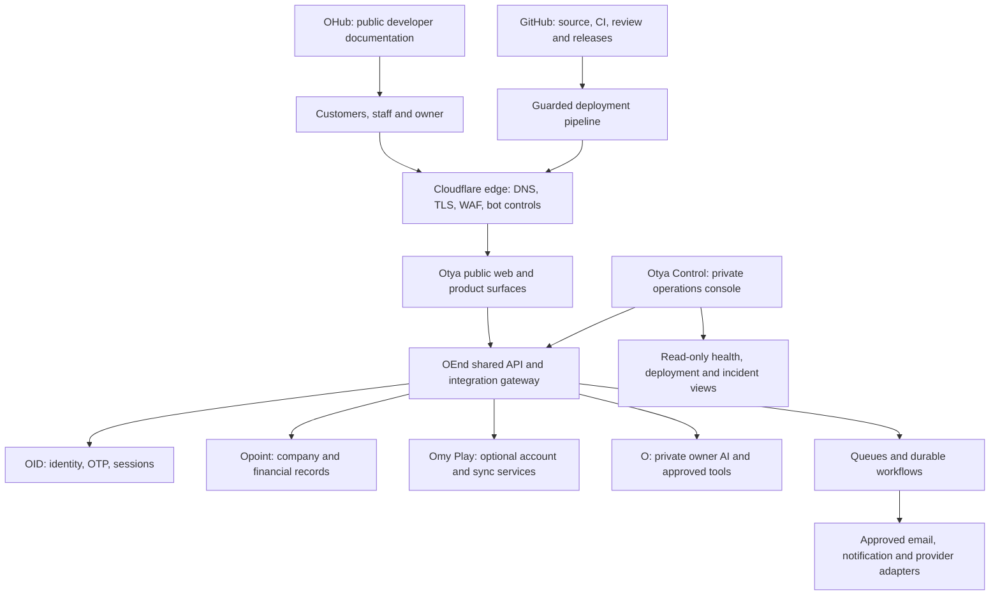

# Otya Ecosystem Upgrade Programme

**Programme date:** 18 November 2026  
**Audience:** Otya contributors, engineering partners and authorised AI development assistants  
**Status:** Consolidated implementation roadmap; each product has its own release gates.

## 1. Programme purpose

Build one coherent Otya product family with clear ownership, consistent identity, secure service boundaries and reliable release practices. Products should feel like parts of one company while keeping customer, business, media and owner data appropriately separated.

The programme is Cloudflare-first, GitHub-managed and designed to grow without turning every product into a separate, overlapping platform.

## 2. Product map and ownership

| Product | Responsibility | Boundary |
|---|---|---|
| **Opoint** | Otya's own retail and mobile-money agency operations | Private company software for authorised Otya owners and workers; not a public SaaS or third-party business-verification service |
| **Omy Play** | Local-first media player and media-library experience | Playback, scanning, search, transfers and Vault remain local-first and usable offline |
| **OEnd** | Shared platform services | Identity, OTP delivery, shared API contracts, messaging and approved provider integrations; it does not become the owner of every product's business records |
| **O** | Private owner AI and technical coordination | Owner-only engineering and operations assistant; separated from customer-facing product experiences |
| **OHub** | Public developer and partner documentation | Public architecture, onboarding, product guides and contribution standards; no secrets or private operating records |

## 3. Shared platform principles

1. **One connected Otya family.** Use consistent product identity, design language, accessible interactions and canonical public branding.
2. **One source of truth per responsibility.** Avoid parallel APIs, competing migration histories and duplicate operational databases.
3. **Cloudflare-first infrastructure.** Use Workers, D1, R2, Queues, KV, Durable Objects and Access where appropriate. Keep infrastructure understandable and economical.
4. **Server-side authority.** The server derives identity, company, branch, work area and permissions. A browser or AI model must never grant itself access by supplying a role or company identifier.
5. **Data separation.** Product databases, memory, logs, storage and integration credentials stay scoped to their owning product.
6. **Privacy by default.** Collect only what a workflow needs. Do not upload local media libraries, Vault content or unnecessary identity information.
7. **Reviewable delivery.** Changes go through branches, pull requests, automated tests, security checks and explicit release gates.
8. **Recoverability.** Production data changes require a backup/recovery plan, migration validation and a documented rollback path.

## 4. Target identity and account policy

**This is the target policy, not a claim that every existing production client and Worker has already been migrated.** Each surface must pass the identity migration and live verification gates in Phase B before being described as compliant.

- OID supports verified email/password and passwordless email-code sign-in. Configured TOTP and recovery codes provide second-factor protection.
- Telegram is an optional destination for Otya notifications, announcements, product updates and events after explicit linking. It must never deliver sign-in, phone-verification, recovery, owner-device or MFA codes.
- Telegram Login, Telegram social sign-in and Telegram Mini App identity must not create an Otya account session. OIDC/widget/Mini App validation can only attach a notification destination to an already authenticated Otya account.
- Owner-device enrollment uses the OID verified-email code and a device-bound owner grant. Telegram is not part of owner access or elevated verification.
- OTPs must be short-lived, rate-limited, single-use, protected against replay and excluded from logs.
- Account email changes require verification of the new address and appropriate reauthentication.
- Privileged owner and administrator actions require stronger authentication and an auditable approval trail.
- Product staging environments must use isolated identity bindings and staging-only credentials. Production identity must not be used as a shortcut for staging tests.

## 5. Opoint product requirements

Opoint is for Otya's own company operations. The first priority is the company's real retail and mobile-money agent work.

### Company and workforce model

- A company contains one or more branches.
- A staff identity is a member of a company; branch membership and work assignments are separately controlled.
- A staff member may be assigned to both **Retail** and **Mobile Money**, but each assignment has its own work area, branch scope and duty role.
- Retail access must not automatically grant access to agency cash, provider float or agency operations.
- Mobile Money access must not automatically grant access to retail stock, purchasing, pricing or finance approval.
- Owner, manager, cashier, agent, accountant and auditor permissions must be explicit and enforced by the API.
- Suspended or revoked assignments must immediately lose access. Permission changes must be audited.

### Retail operations

The intended foundation includes product catalogue, inventory locations, stock movements, point-of-sale sales, customers, suppliers, purchases, expenses, reconciliation and operational reporting.

### Mobile Money agency operations

The intended foundation includes provider-specific operator workflows, cash drawer and float records, commission records, reversals, end-of-day reconciliation and auditable transaction references.

Retail and agency accounting streams must remain distinct. A worker's ability to use both areas is granted through separate assignments, not by merging the two roles into one unrestricted permission.

### Financial integrity

- Store UGX amounts as whole-shilling integers.
- Use idempotency keys for retryable operations.
- Keep posted ledgers and operational histories append-only; correct mistakes through authorised compensating entries.
- Journal entries must balance before posting.
- Provider timeouts or uncertain results remain pending/unknown until independently reconciled.
- An operator-entered SMS or receipt is evidence for review, not proof that a provider transaction succeeded.
- Keep Quickteller Business and InterSwitch Marketplace Routing as separate provider integrations and identities.
- Payment execution, airtime/data, bill payments, EFRIS submission and other regulated/provider-dependent actions remain disabled until the exact provider approval, contract, technical controls and applicable legal requirements are verified.

## 6. Omy Play product requirements

Omy Play is a privacy-focused, local-first media application.

- Playback, media scanning, folders, local search, file transfer and Vault must work without an account or internet connection where the feature is designed to be local.
- Online services should be limited to product configuration, release/update metadata, device registration, crash reporting, feedback and opt-in notifications.
- Never upload a user's local media library, local paths, playback history or Vault contents by default.
- AI must remain optional and disabled unless a separate privacy and product decision enables a narrowly scoped feature.
- Firebase may support appropriate mobile attestation and notification services; it must not become the source of truth for product data.
- Release builds require a verified application identity, real release-signing process, upgrade tests, ABI checks and artifact verification.

## 7. OEnd shared platform requirements

OEnd provides shared services with narrow, documented contracts:

- OID authentication and OTP lifecycle.
- Email delivery and authenticated Telegram notification-destination linking.
- Internal service-to-service authentication.
- Product API routing and shared integration adapters.
- Provider callback verification, idempotency and status reconciliation.
- Central security, monitoring and release conventions.

Shared services must not bypass product authorization or directly mutate Opoint financial records. Every product remains responsible for its own data and business rules.

## 8. O private owner-AI requirements

O is an owner-facing coordinator for engineering and company operations, not a public chatbot.

Its approved operating levels are:

1. **Read:** inspect approved repository, build, security and operational information.
2. **Analyse:** explain issues, compare options and recommend a change.
3. **Draft:** create reviewable documentation, tests and pull requests.
4. **Prepare approved actions:** produce an exact action preview and obtain human approval.
5. **Execute limited commands:** only through deterministic APIs that re-check identity, permissions, state, idempotency and audit requirements.

The model itself is never an authorization authority. It must not directly write financial tables, approve payments, grant staff access, reveal secrets, delete production resources or publish releases without the applicable human-approved release process.

O's memory and tool permissions stay separate from Opoint company data and Omy Play user data. Retrieved documents, customer messages and external content are untrusted input.

## 9. Domain, design and public surfaces

- Use the canonical Otya public domain family under **otya.site**.
- Public product surfaces should use their product names rather than internal Worker, database or legacy project names.
- Keep old hostnames only for a controlled transition while links, clients, certificates and traffic are verified.
- Remove a legacy hostname only after public smoke tests and usage evidence show it is no longer required.
- OHub documentation must describe public product capabilities without exposing internal service credentials, account identifiers, private operational findings or personal data.
- All products should use clear loading, empty, error, pending, offline and permission-denied states.

## 10. Delivery sequence

### Phase A — Consolidate the platform foundation

- Establish a single authoritative repository and runtime responsibility for each product.
- Reconcile overlapping pull requests and migration numbering.
- Standardise code quality, dependency pinning, security scans, environment naming and operational documentation.
- Keep production databases and existing backups intact.

**Acceptance:** one clear source of truth per product, no conflicting production-bound migrations, passing baseline CI and recoverable staging environments.

### Phase B — Complete OID and domain transition

- Validate email OTP, TOTP/recovery codes, expiry, rate limits, replay prevention, refresh, logout, revocation and Telegram notification linking without session issuance.
- Deploy and test isolated staging identity with dedicated staging-only credentials.
- Rebind product staging environments only after identity staging is healthy.
- Complete canonical-domain application configuration and public HTTP/browser smoke tests.

**Acceptance:** all staging products use the isolated identity service; sign-in is email OTP based; Telegram sign-in is unavailable; canonical public hosts pass functional and security checks.

### Phase C — Complete Opoint

- Consolidate the new isolated Opoint backend as the single product API and database model.
- Integrate company branches, work-area assignments, separate Retail and Mobile Money permissions, staff onboarding, inventory, purchases, expenses and audit history.
- Complete branch-scoped agency cash/float records and reporting without reusing Retail balances.
- Complete sandbox-only provider adapters and reconciliation contracts.
- Build API-backed owner, manager, retail and agency workspaces.

**Acceptance:** role and branch tests prove isolation; stock and ledgers reconcile; unknown provider outcomes remain unresolved; no live financial execution is enabled by default.

### Phase D — Complete Omy Play

- Finish the identity boundary and staged backend cutover.
- Coordinate Flutter, Kotlin, Android Gradle Plugin and Gradle wrapper versions as one tested toolchain.
- Validate offline playback, media scanning, Vault, device registration, update/install/upgrade and crash/feedback flows on Android devices.
- Complete signing, privacy, backup, monitoring and FCM release gates.

**Acceptance:** Android tests and signed release verification pass; the product works offline; no private media/Vault data is uploaded.

### Phase E — Complete O and OHub

- Finish O's owner-only access model and private staging runtime.
- Separate O's memory, data and tool permissions from all customer products.
- Add reviewable repository, build and operational workflows with explicit approval for restricted actions.
- Finalise public OHub developer documentation and contribution guidance.

**Acceptance:** O is owner-scoped, auditable and least-privilege; OHub exposes public documentation only.

### Phase F — Production release and operations

- Run security, dependency, API contract, integration, device and end-to-end tests.
- Complete D1/R2 backup and restore rehearsals.
- Verify DNS, TLS, routing, service bindings, monitoring and incident procedures.
- Release one product or shared component at a time with an explicit owner-approved deployment and rollback plan.
- Verify the live service after each deployment; a passing build alone is not proof of release.

**Acceptance:** all enabled features have passing checks, live smoke evidence, monitoring, recovery instructions and an approved rollback path.

## 11. Explicit non-goals and safety gates

- No public third-party business-verification network or public SaaS for Opoint in the first release.
- No unapproved real-money movement, live provider execution or financial service expansion.
- No client-side authorization or direct browser writes to financial databases.
- No cross-product sharing of private media, Vault content, business records or owner-AI memory.
- No secrets in source code, public documentation, mobile builds or logs.
- No deletion of production data, backups, restore-verification resources or legacy asset stores as cosmetic cleanup.
- No production migration or deployment solely because a branch is green.

## 12. Definition of done

The ecosystem is considered upgraded only when each product independently satisfies its acceptance criteria, integrations are verified end-to-end, access boundaries are tested, production data is recoverable, public surfaces use canonical branding, and each production release has a recorded owner approval and live verification result.

A product may be complete for its current approved scope while another product remains in staging. The programme must report those states honestly rather than describing the entire ecosystem as live.

## 13. Platform excellence, performance and Otya Control

This section defines the target operating standard for the ecosystem. These are acceptance requirements, not claims that every control or measurement is already deployed.

### Target service topology

Keep one authoritative owner for each responsibility. Shared services provide narrow contracts; they must not become a second copy of every product backend.

Otya Control is the private operational capability and evidence layer behind O, not a second backend, data store or competing owner dashboard. The existing O Android application and its Company Workspace, Pulse, Activity and Connections surfaces remain the primary owner experience. O coordinates reasoning and approvals; Control provides governed operational evidence and deterministic APIs. A minimal browser recovery surface may be considered only for continuity when the mobile owner interface is unavailable, and must not duplicate normal owner workflows. Both remain subject to server-side identity, scoped permissions and human approval for sensitive actions.

### Cloudflare and platform responsibilities

- **Workers:** application logic and small, clearly owned service boundaries. Prefer service bindings for internal calls instead of exposing additional public endpoints.
- **D1:** transactional records owned by the relevant product. Keep identity, retail, agency, media-account and owner-operation data within their defined boundaries.
- **R2:** object storage for product assets and recovery artefacts. Define retention, access, integrity verification and restore procedures per bucket.
- **Queues:** asynchronous work with bounded batches, retry limits, idempotent consumers and dead-letter handling.
- **Workflows:** multi-step operations that need durable progress, waits, retries or resumability.
- **KV:** read-heavy configuration and cache-like data only where its consistency model is suitable; do not use it as a substitute for transactional records.
- **Durable Objects:** introduce only where a concrete per-entity coordination or strongly ordered shared-state requirement exists.
- **Turnstile, WAF, rate limiting and Access:** apply at the relevant public or private boundary. Rules must be scoped to the actual route and traffic pattern, tested for false positives and monitored after rollout.

Do not add a Cloudflare product merely because it exists. Each binding, database, queue, namespace, Worker and public route must have a named owner, purpose, environment and lifecycle. Consolidate only after confirming references, data, bindings, traffic and recovery requirements.

### Security and privacy baseline

- Require server-side authorization on every protected action and every product-owned data query. The browser, mobile client and AI model are never authorization authorities.
- Use distinct service identities, least-privilege credentials and narrow scopes. Keep secrets in managed secret storage, never in source, client bundles, logs or public documentation.
- Protect owner and administrator access with strong authentication, reauthentication for sensitive operations, session revocation and auditable approvals.
- Apply rate limits by endpoint and abuse model. Use bot challenges where appropriate, not as a substitute for application authorization.
- Maintain an application-owned Content Security Policy. Avoid conflicting or duplicated header ownership between the edge and application.
- Log security and operational events with request correlation while excluding passwords, OTPs, bearer tokens, raw message bodies and unnecessary personal data.
- Review dependency and source security findings on every release. Critical and high-severity findings must be fixed or explicitly risk-accepted by the authorised owner before production.
- Strengthen email-domain authentication progressively. Move DMARC enforcement only after reviewing aggregate reports and confirming all legitimate senders are aligned.
- Maintain tested backup, restore, retention, export and account-deletion procedures for each data-owning service.

### Performance and efficiency baseline

Measure first, then optimize against repeatable baselines. Separate synthetic measurements from real-user and real-device measurements.

**Web experience**
- Target Core Web Vitals at the 75th percentile: LCP at or below 2.5 seconds, INP at or below 200 milliseconds and CLS at or below 0.1.
- Establish page-level budgets for JavaScript, CSS, fonts, image bytes and third-party scripts.
- Use responsive images, modern formats, explicit dimensions, lazy loading below the fold and preloading only for critical resources.
- Cache fingerprinted static assets for long periods. Keep authenticated pages, account responses, private APIs and financial data out of shared public caches.
- Test mobile, slow-network and reduced-motion behaviour rather than optimizing only for a desktop connection.

**APIs and data**
- Record p50, p95 and p99 latency by route and dependency, plus error rate, timeout rate and request volume.
- Set service-specific latency budgets only after collecting a representative baseline. Avoid one global target that hides a slow or high-risk endpoint.
- Review D1 query plans and indexes for high-volume paths. Avoid N+1 queries, repeated lookups and unnecessary full-table scans.
- Bound payload size, pagination, concurrency, retries and downstream subrequests.
- Move non-interactive work to queues or durable workflows where doing so improves user response time without weakening consistency.
- Add caching only where invalidation, privacy and consistency are understood.

**Mobile and local-first behaviour**
- Measure cold start, warm start, frame timing, memory, battery use, storage growth, scan time, large-library behaviour and network consumption on representative devices.
- Keep Omy Play's core local playback and media management independent of account or cloud availability.
- Make sync, downloads, notifications and background work resilient to interrupted connectivity and Android lifecycle restrictions.

### Stability, observability and recovery

Every production service should expose a documented health/readiness contract and emit privacy-safe telemetry. The operational baseline includes:

- Request volume, latency distributions, error rates and dependency health.
- Worker exceptions and CPU/subrequest pressure where available.
- D1 migration state, query errors and backup/restore readiness.
- Queue backlog age, retry volume, poison messages and dead-letter counts.
- Resend delivery, bounce, complaint and signed-webhook processing outcomes.
- Authentication failures, abuse signals, session revocation and security-event trends.
- Deployment version, release identity, configuration drift and rollback readiness.

Use alerts that lead to an action. Deduplicate repeated incidents, include a runbook and owner, and distinguish a degraded dependency from a failed product. Define service-level indicators and error budgets for the critical services before adopting aggressive availability claims.

Recovery requirements:
1. Export or otherwise protect affected production data before a schema or high-impact configuration change.
2. Validate migration ordering, integrity constraints and application compatibility before deployment.
3. Keep a tested rollback or forward-repair plan; database rollback must not be assumed safe for every migration.
4. Rehearse restores in an isolated environment and verify application-level integrity, not only that a backup file exists.
5. After deployment, verify the exact Worker version, bindings, migrations and public authenticated flows.
6. Stop the rollout when a gate fails. Do not deploy downstream components after a shared dependency fails its gate.

### Usability, accessibility and trust

- Apply the approved Otya brand system consistently without altering the supplied master logo artwork.
- Provide predictable navigation, clear labels, visible focus, keyboard operation, readable contrast and accessible status announcements.
- Aim for WCAG 2.2 AA across public and account experiences.
- Every important flow must have clear loading, success, empty, validation, pending, retry, offline, permission-denied and recovery states.
- Explain why a user is being asked for information or permission. Do not silently collect optional telemetry or upload local/private data.
- Make notifications actionable and appropriately prioritised; avoid repeated or redundant alerts.
- Keep language, naming, dates, currencies and support routes consistent across products.

### Otya Control — private ecosystem operations console

Build Otya Control in stages, starting read-only. It should consolidate approved operational evidence without becoming a privileged shortcut around product boundaries.

**Read-only foundation**
- Product and service inventory, owners, environments and dependencies.
- Current deployed versions and the matching GitHub commit/release.
- Workflow history, validation failures and deployment outcomes.
- Cloudflare Worker, domain, route and binding inventory.
- D1 migration and backup/restore readiness.
- Queue backlog, retry and dead-letter status.
- Resend delivery and webhook processing summaries.
- Incidents, recovery state, service health and performance indicators.

**Guarded operations**
- Show a precise action preview, target environment, affected resources and expected impact before execution.
- Require a separately authenticated operator and explicit approval for production deployments, migrations, permission changes, secret rotation and destructive operations.
- Use idempotency keys and immutable audit events for supported actions.
- Enforce product-specific authorization in the owning service. The console must not write directly to financial or identity tables.
- Provide cancellation and rollback only where the underlying operation supports them safely.
- Keep an emergency break-glass path separately controlled, logged and reviewed.

**Definition of readiness**
- All displayed health and deployment states link to authoritative evidence and show when they were last refreshed.
- A green CI run is not labelled a live production deployment.
- No secret values, raw authentication tokens or unnecessary customer content are displayed.
- Read-only access remains useful when action permissions are unavailable.
- A failed or partially completed action is shown as such; the console never reports success before the underlying service confirms it.

### Programme-level acceptance gates

| Dimension | Acceptance requirement |
|---|---|
| Web performance | Core Web Vitals targets measured at the 75th percentile |
| API performance | Route-level p50/p95/p99 baseline and agreed budget |
| Security | No unresolved critical/high release finding without documented owner risk acceptance |
| Access control | Automated tests for role, tenant, branch and product boundaries |
| Data safety | Verified backup and successful isolated restore rehearsal for critical data |
| Reliability | Health checks, meaningful alerts, runbooks and tested recovery paths |
| Delivery | Every production release tied to a reviewed commit, migration state and live smoke evidence |
| Cost and complexity | Every infrastructure resource has an owner and purpose; duplicate resources are retired only after dependency and data checks |
| User experience | Accessibility, responsive, offline/error-state and real-device acceptance |
| Operations console | Read-only evidence first; sensitive actions require server-side authorization and explicit approval |

These gates apply per product and per release. Do not mark the whole ecosystem complete until each enabled service has its own evidence.

